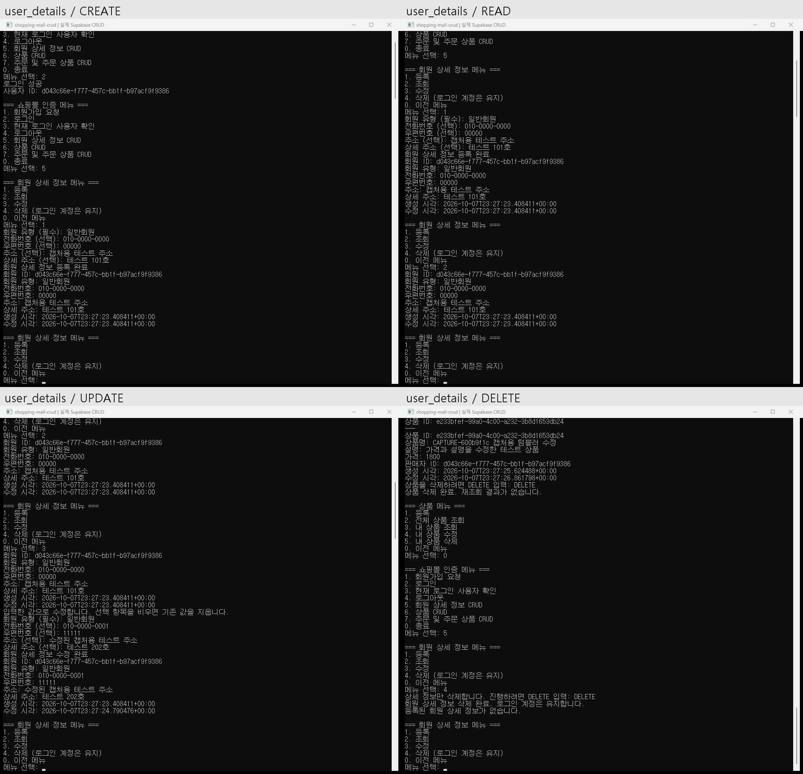
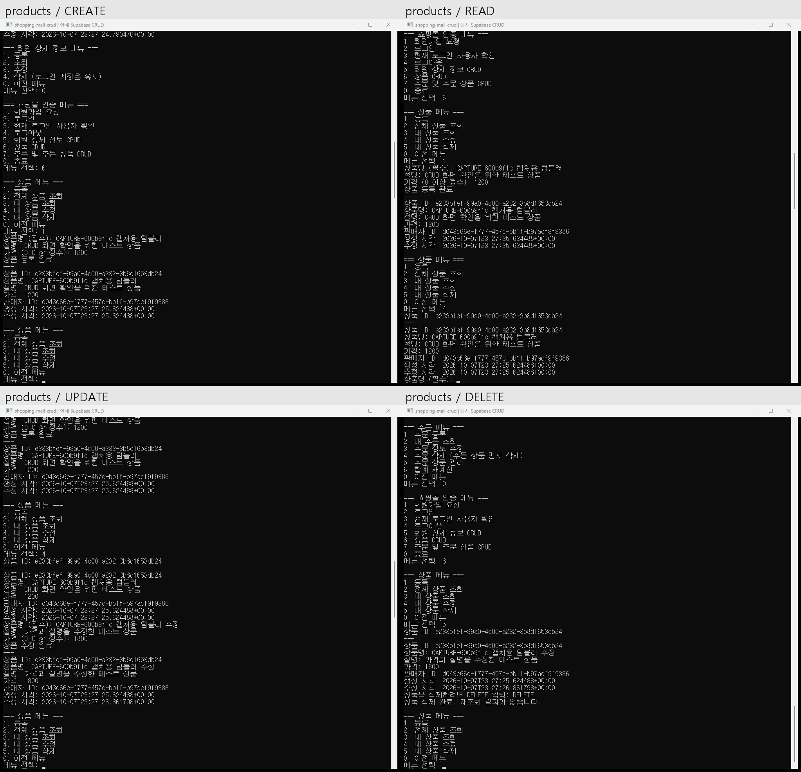
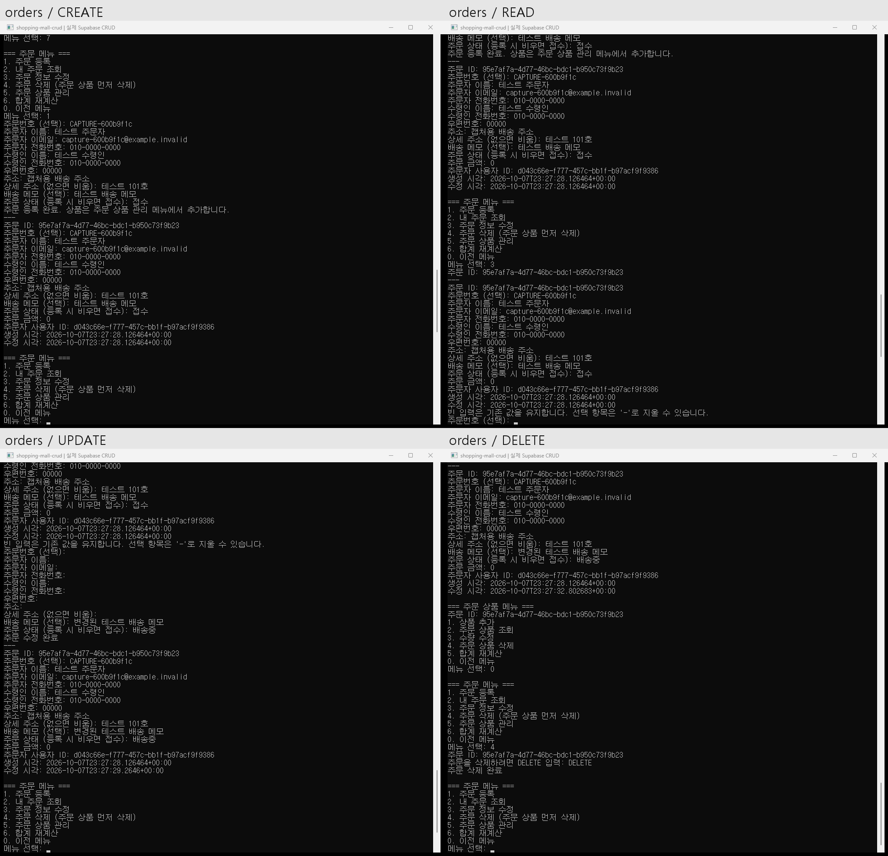
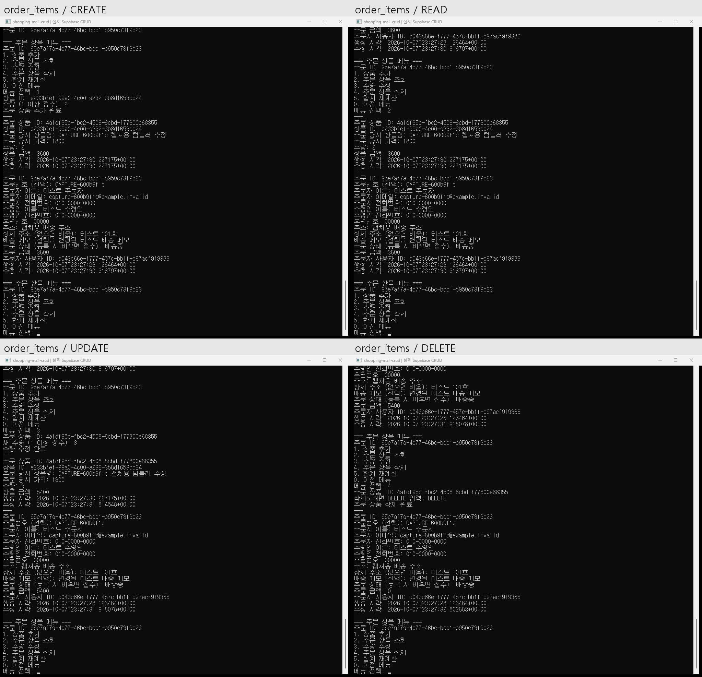

# Shopping Mall CRUD — Python × Supabase

Python과 Supabase로 구현한 **터미널 기반 쇼핑몰 데이터 관리 학습 프로젝트**입니다. Supabase Auth로 인증하고, 회원 상세 정보·상품·주문·주문 상품을 생성·조회·수정·삭제합니다. PostgreSQL의 테이블 관계와 행 수준 보안(RLS)을 함께 학습하는 데 초점을 맞췄습니다.

- **제작자:** 홍정기
- **실행 형태:** Python CLI — 브라우저용 쇼핑몰 화면은 포함되어 있지 않습니다.
- **관리 대상:** `user_details`, `products`, `orders`, `order_items`

> 학습용 프로젝트입니다. 별도의 실습용 Supabase 프로젝트와 가상 회원·주문 정보를 사용하세요. 환경변수 파일, 로그인 비밀번호, 액세스 토큰은 저장소에 올리지 않습니다.

## 주요 기능

| 영역 | 구현 내용 |
| --- | --- |
| 인증(Authentication) | 회원가입 요청, 이메일·비밀번호 로그인, 현재 사용자 확인, 로그아웃 |
| 회원 상세 정보 | 로그인한 본인의 연락처·배송 주소 등 CRUD |
| 상품 | 상품 등록, 전체/내 상품 조회, 본인 상품 수정·삭제 |
| 주문 | 본인 주문 등록·조회·정보 수정·삭제 |
| 주문 상품 | 주문에 상품 추가, 목록 조회, 수량 수정, 삭제 |
| 금액 관리 | 주문 상품의 가격 × 수량 합산, 변경 후 합계 갱신, 수동 재계산 |
| 접근 제어 | 로그인 사용자 ID 기반 필터와 DB의 RLS 정책 |
| 입력 및 삭제 보호 | 필수 입력·정수 범위 검사, `DELETE` 확인 입력, FK 참조 삭제 제한 |

## 사용 기술

| 기술 | 용도 |
| --- | --- |
| Python 3.13 이상 | CLI, 입력 검사 및 CRUD 흐름 |
| Supabase Python SDK | Auth와 테이블 API 호출 |
| PostgreSQL | 테이블, UUID, PK/FK, 제약조건 및 RLS |
| python-dotenv | `.env`에서 연결 정보와 실습 계정 정보 로딩 |
| uv | 가상환경·의존성 관리 및 잠금 파일 |

Python 버전 핀은 `.python-version`의 `3.13`이며, 의존성 선언과 고정 결과는 각각 `pyproject.toml`, `uv.lock`에 포함되어 있습니다.

## 프로젝트 구조

```text
.
├── main.py                 # Supabase 연결, 인증 및 최상위 메뉴
├── members.py              # 본인 회원 상세 정보 CRUD
├── products.py             # 상품 CRUD 및 가격 검사
├── orders.py               # 주문·주문 상품 CRUD와 합계 관리
├── time_utils.py           # 생성·수정 시각 문자열 생성
├── pyproject.toml          # Python 버전 조건과 의존성
├── uv.lock                 # 의존성 잠금 파일
├── .python-version         # Python 3.13 핀
├── .env.example            # 환경변수 작성 예시
├── .gitignore              # 비밀 설정·가상환경·캐시 제외
├── sql/
│   ├── 01_schema.sql       # 테이블·제약조건 생성 및 RLS 활성화
│   ├── 02_rls.sql          # 로그인 사용자별 접근 정책
│   └── verify_schema.sql   # 구조·제약조건·RLS 읽기 전용 확인
└── docs/screenshots/
    └── crud-4cf9b9968a/     # 기존 CRUD 실행 캡처와 기록
```

## 데이터베이스 구성

| 테이블 | 주요 역할 | 관계 |
| --- | --- | --- |
| `auth.users` | Supabase가 관리하는 인증 계정 | 직접 생성하거나 수정하지 않음 |
| `user_details` | 회원 유형, 연락처, 우편번호·주소 | `id` → `auth.users.id` |
| `products` | 상품명, 설명, 가격, 판매자 | `seller_id` → `auth.users.id` |
| `orders` | 주문자·수령인, 배송지, 합계, 상태 | `user_id` → `auth.users.id` |
| `order_items` | 주문 당시 상품명·가격, 수량 | `order_id` → `orders.id`, `product_id` → `products.id` |

- 상품·주문·주문 상품의 ID는 UUID로 자동 생성됩니다.
- 회원 상세 정보의 ID는 현재 로그인 사용자의 Auth ID를 사용합니다.
- 상품명과 단가는 주문 상품을 추가하는 시점에 복사합니다. 이후 상품 정보를 바꿔도 기존 주문 상품의 값은 자동 변경되지 않습니다.
- FK는 `ON DELETE RESTRICT`로 설정되어 있습니다. 주문 상품이 참조하는 상품이나 주문을 먼저 삭제할 수 없습니다.
- `deleted_at` 컬럼은 존재하지만, 현재 삭제 구현은 `.delete()`를 사용하는 **물리 삭제**입니다.

### RLS 접근 정책

`sql/02_rls.sql`은 다음 정책을 정의합니다.

- 회원 상세 정보: 본인의 `id`에 해당하는 행만 관리
- 상품 조회: 로그인한 사용자는 모든 상품 조회 가능
- 상품 변경: `seller_id`가 본인인 상품만 등록·수정·삭제
- 주문: `user_id`가 본인인 주문만 관리
- 주문 상품: 본인 주문에 속한 내역만 관리

회원 유형인 `type`은 정보 필드이며, 별도의 관리자·판매자 역할 권한 시스템은 구현되어 있지 않습니다.

## 설치 및 실행

### 1. 저장소 복제와 의존성 설치

Python 3.13 실행 환경과 `uv`를 준비한 뒤 실행합니다.

```bash
git clone https://github.com/Jeong-Hong/CH2_database_supabase_shopping_mall.git
cd CH2_database_supabase_shopping_mall
uv sync --frozen
```

### 2. Supabase 데이터베이스 준비

**기존 서비스가 아닌 새 실습용 프로젝트**의 SQL Editor에서 다음 순서로 적용합니다.

1. `sql/01_schema.sql` — 테이블과 FK 생성, RLS 활성화
2. `sql/02_rls.sql` — 로그인 사용자별 정책 생성
3. `sql/verify_schema.sql` — 쿼리를 하나씩 실행해 구조·제약조건·RLS 확인

`01_schema.sql`만 적용하면 RLS는 활성화되지만 접근 정책은 아직 없습니다. CRUD 실습 전에 `02_rls.sql`까지 적용해야 합니다. 제공된 SQL은 기존 테이블이나 동일 이름의 정책이 있으면 오류가 발생하도록 작성되어 있으므로, 반복 실행용 마이그레이션으로 사용하지 마세요.

### 3. 환경변수 설정

저장소 루트의 `.env.example`을 복사해 같은 위치에 `.env`를 만들고 본인의 실습 환경에 맞게 채웁니다.

```dotenv
SUPABASE_URL=https://your-project-ref.supabase.co
SUPABASE_PUBLISHABLE_KEY=your-publishable-key
SUPABASE_TEST_EMAIL=your-test-email
SUPABASE_TEST_PASSWORD=your-test-password
```

- 위 값은 설명용 자리표시자입니다. 실제 값은 로컬 `.env`에만 작성합니다.
- 앱은 `SUPABASE_PUBLISHABLE_KEY`와 로그인 세션을 사용하는 구조입니다. `service_role` 또는 secret 키로 대체하지 마세요.
- 현재 인증 메뉴는 이메일·비밀번호를 터미널에서 받지 않고 위 환경변수의 실습 계정을 사용합니다.
- 회원가입 후 이메일 확인이 필요한 프로젝트에서는 확인 절차를 마친 뒤 로그인합니다.
- `.env`를 수정한 경우 프로그램을 다시 실행합니다.

### 4. 시간대 확인 후 실행

현재 `time_utils.py`는 로컬 시각에 `+09:00`을 붙입니다. **실행하는 운영체제 시간대를 한국 표준시(KST, UTC+09:00)로 설정해야 합니다.** 다른 시간대에서 그대로 실행하면 실제 시각과 다른 값이 저장될 수 있습니다.

```bash
uv run main.py
```

## 사용 흐름

최상위 메뉴는 다음과 같습니다.

```text
=== 쇼핑몰 인증 메뉴 ===
1. 회원가입 요청
2. 로그인
3. 현재 로그인 사용자 확인
4. 로그아웃
5. 회원 상세 정보 CRUD
6. 상품 CRUD
7. 주문 및 주문 상품 CRUD
0. 종료
```

권장 실습 순서:

1. 실습 계정으로 회원가입 또는 로그인합니다.
2. 회원 상세 정보를 등록하고 조회·수정합니다.
3. 상품을 등록하고 상품 ID를 확인합니다.
4. 주문을 등록하고 주문 ID를 확인합니다.
5. 주문 상품 관리 메뉴에서 상품 ID와 수량으로 항목을 추가합니다.
6. 주문 상품 조회·수량 수정·합계 재계산을 확인합니다.
7. 삭제 실습은 **주문 상품 → 주문 → 상품** 순서로 진행합니다.
8. 회원 상세 정보를 삭제해도 Auth 로그인 계정은 유지됩니다.

### 수정·삭제 시 유의 사항

- 회원 상세 정보 수정: 선택 항목을 비우면 기존 값이 지워집니다.
- 주문 정보 수정: 빈 입력은 기존 값을 유지합니다. 선택 항목과 상세 주소는 `-`로 비울 수 있습니다.
- 상품 가격은 0 이상, 수량은 1 이상의 정수이며 코드에서 `int4` 범위를 확인합니다.
- 삭제 메뉴는 `DELETE` 확인 입력을 요구합니다. 삭제한 행을 되돌리는 기능은 없습니다.

## 기존 실행 스크린샷

아래 이미지는 프로젝트 폴더에 보관되어 있던 CRUD 실행 기록입니다. 각 이미지는 생성·조회·수정·삭제 화면을 모았습니다. 이번 저장소 업로드 과정에서 실제 DB 쓰기 작업을 다시 실행한 것은 아닙니다.

### 회원 상세 정보



### 상품



### 주문



### 주문 상품



개별 실행 캡처와 기존 기록의 메타데이터는 같은 폴더에서 확인할 수 있습니다. 화면에 사용된 연락처·주소·이메일은 테스트용 예시입니다.

## 현재 제한 사항

- **트랜잭션:** 주문 상품 변경과 주문 합계 갱신은 별도의 API 호출입니다. 하나의 원자적 트랜잭션이 아니므로 합계 갱신 실패 안내가 나오면 재계산 메뉴로 복구해야 합니다. 동시 수정까지 완전하게 처리하지는 않습니다.
- **시간대:** KST 실행 환경을 전제로 합니다. 시간대에 독립적인 aware datetime 방식으로 개선할 수 있습니다.
- **보안 경계:** Python의 입력 검사와 필터만으로는 DB 무결성을 모두 보장하지 않습니다. 현재 SQL에는 가격·수량 CHECK 제약이나 합계 자동 계산 트리거가 없습니다.
- **조회·확장:** 페이지네이션, 재고·결제·배송 API, 웹 UI, 별도 관리자 기능은 없습니다.
- **검증:** SQL 확인 스크립트와 기존 실행 캡처가 포함되어 있지만, 저장소에 별도 자동화 통합 테스트 모음은 없습니다.

## 오류 확인 가이드

| 증상 | 확인할 내용 |
| --- | --- |
| 연결 초기화 실패 | `.env` 위치, URL·공개 키 값, 패키지 설치 여부 |
| 회원가입 후 세션 없음 | Supabase의 이메일 확인 설정, 받은 이메일, 기존 계정 여부 |
| 로그인 실패 | 실습 계정 이메일·비밀번호, 이메일 확인 상태, 인터넷 연결 |
| 조회 결과 없음 또는 쓰기 실패 | 로그인 사용자, 소유자 ID, RLS SQL 적용 여부 |
| 상품·주문 삭제 실패 | 해당 행을 참조하는 주문 상품이 남아 있는지 확인 |
| 주문 합계 갱신 실패 | 본인 주문의 합계 재계산 메뉴 실행 |
| 시각이 맞지 않음 | 운영체제 시간대가 KST인지 확인 |

오류 메시지를 공유할 때 `.env`, 비밀번호, 인증 응답 원문 또는 토큰이 함께 노출되지 않도록 주의하세요.

## 학습 포인트

- Supabase Auth와 사용자 ID 기반 데이터 연결
- 관계형 데이터베이스의 PK·FK·UNIQUE·NOT NULL 제약
- Python SDK의 `insert`, `select`, `update`, `delete`
- 앱 필터와 DB RLS 정책의 역할 구분
- 주문 시점 데이터 스냅샷과 합계 관리
- 환경변수 분리, 예외 처리, 삭제 후 재조회
- 여러 API 호출과 DB 트랜잭션의 차이
